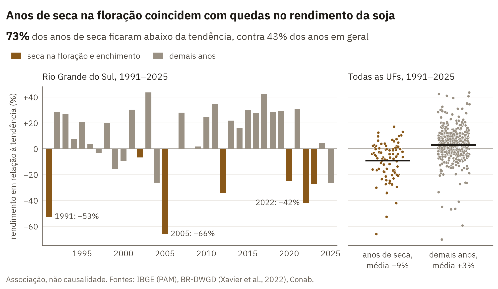
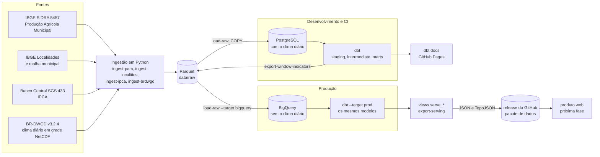

# Atlas da Lavoura

[](https://github.com/alveshenriique/atlas-da-lavoura/actions/workflows/ci.yml)
[](https://alveshenriique.github.io/atlas-da-lavoura/)

Pipeline de engenharia de dados que cruza a produção agrícola municipal do IBGE (soja, milho e café, 1974–2025) com o IPCA do Banco Central e com o clima diário em grade do BR-DWGD, para responder de onde veio o crescimento da produção, como a fronteira agrícola migrou, quanto a produção se concentra e como anos de seca e calor se associam a quedas de rendimento.

<picture>
  <source media="(prefers-color-scheme: dark)" srcset="docs/img/soybean_yield_anomaly_rs_dark.png">
  
</picture>

<sub>[Paleta baseada no guia visual do IPCC e testada para daltonismo](docs/DECISOES.md#identidade-visual)</sub>

## Status

Concluído:

1. Repositório, PostgreSQL 18 em Docker, projeto Python com uv.
2. Ingestão da PAM (SIDRA 5457), das Localidades do IBGE e do IPCA (BCB) para Parquet.
3. Carga da camada raw no Postgres com `COPY`, idempotente, uma transação por arquivo.
4. dbt: staging, intermediate e marts (modelo dimensional e marts analíticos).
5. Testes de dados e CI no GitHub Actions, com uma amostra real de 7 municípios.
6. Clima: BR-DWGD agregado por município (93,6 milhões de linhas município × dia), janelas fenológicas, anomalias e associação clima × rendimento.
7. Auditoria: validação externa contra os totais do IBGE e a série da Conab, análise de sensibilidade e correções.
8. SQL portável (Postgres e BigQuery no mesmo código dbt).
9. BigQuery em produção (região `southamerica-east1`, modo sandbox): sobem os dados e os modelos derivados, sem o clima diário, e os dois bancos foram validados tabela a tabela.
10. Camada de servir dados: views `serve_*` e o comando `export-serving` geram os arquivos do site (JSON pré-agregado e malha simplificada em TopoJSON), validados por JSON Schema e conciliados com os marts; o pacote de cada versão vai para um release do GitHub ([contrato dos dados](docs/CONTRATO_DE_DADOS.md)).

Próximos passos: publicar o primeiro pacote de dados e construir o produto web.

## Arquitetura



Cada camada é idempotente: reexecutar a ingestão ou a carga não duplica dados. O clima passa por uma agregação espacial (média das células da grade dentro de cada município) antes de entrar na raw, e o Postgres o guarda numa tabela particionada por ano. O CI roda o pipeline inteiro, da carga ao último teste do dbt, sobre a amostra versionada em `tests/fixtures/raw/`. Em produção, o BigQuery recebe tudo menos o clima diário: os indicadores climáticos por janela, calculados no Postgres, sobem como uma fonte derivada, e o dbt constrói ali os mesmos modelos. O site não vai consultar o warehouse: a camada de servir dados gera, a partir dele, arquivos pequenos e pré-agregados, que vão para um release do GitHub e daí para a CDN (ver [BigQuery em produção](docs/DECISOES.md#bigquery-em-produção-sandbox-e-arquitetura-enxuta) e [Camada de servir dados](docs/DECISOES.md#camada-de-servir-dados-arquivos-estáticos-para-o-site)).

## Como rodar

Pré-requisitos: Git, Docker com Compose e [uv](https://docs.astral.sh/uv/). Testado em Ubuntu 24.04.

### Caminho rápido: amostra de 7 municípios (alguns minutos)

Usa os mesmos arquivos que o CI. Não acessa nenhuma API.

```bash
git clone https://github.com/alveshenriique/atlas-da-lavoura.git
cd atlas-da-lavoura
cp .env.example .env
docker compose up -d --wait
uv sync
uv run load-raw --data-dir tests/fixtures/raw
cd dbt
uv run --env-file ../.env dbt deps
uv run --env-file ../.env dbt build
```

O `dbt build` termina com todos os testes passando e 1 aviso esperado (um rendimento de 1998 publicado como zero pelo IBGE em Areias-SP). Com a amostra, os z-scores climáticos ficam nulos (a normal de 1991–2020 não existe nela) e os testes que comparam com os totais oficiais passam vazios; os números não têm significado analítico. Para navegar a documentação dos modelos localmente: `uv run --env-file ../.env dbt docs generate` e `uv run --env-file ../.env dbt docs serve`.

Para parar o banco: `docker compose down` (os dados ficam no volume; `docker compose down -v` apaga tudo).

### Caminho completo: dados reais

Os mesmos passos iniciais (clone, `.env`, `docker compose up -d --wait`, `uv sync`) e depois as ingestões reais. Reserve cerca de 35 GB de disco (24 GB de NetCDF em `data/external/`, 1,3 GB de Parquet, 7 GB no Postgres) e de 1 a 2 horas:

```bash
uv run ingest-pam          # 184 requisições à API SIDRA, de 30 a 60 min
uv run ingest-localities   # segundos
uv run ingest-ipca         # segundos
uv run ingest-brdwgd       # baixa 8,5 GB do BR-DWGD (cerca de 20 min) e agrega por município (cerca de 5 min)
uv run load-raw            # cerca de 6 min (5,1 milhões de linhas da PAM e 93,6 milhões de clima)
cd dbt
uv run --env-file ../.env dbt deps
uv run --env-file ../.env dbt build   # cerca de 6 min; 3 avisos esperados
```

Os 3 avisos são conhecidos e documentados: os 28 rendimentos de 1998 publicados como zero, as 30 UF-safras em que a PAM e a Conab divergem em mais de 10% e os 2 eventos climáticos do MATOPIBA em 2016 que não acionam a classe de déficit na janela crítica. Reexecutar qualquer comando é seguro: partições já baixadas são puladas (os 2 anos mais recentes da PAM são sempre rebaixados), arquivos já carregados são pulados e o dbt reconstrói as tabelas.

## Principais resultados

Soja, com os dados completos ingeridos em setembro de 2026 e depois das correções da auditoria:

- Nos **537 UF-anos** com normal climatológica e tendência de rendimento, a anomalia média de rendimento é de **−9%** nos anos de seca na floração e no enchimento, contra **+3%** nos demais.
- **73%** dos anos de seca ficaram abaixo da tendência, contra **43%** dos anos em geral.
- Em **197 das 217** regiões imediatas produtoras, a correlação entre o balanço hídrico e a anomalia de rendimento é positiva.

Esses números medem associação, não causalidade: preço, pragas, tecnologia e política também entram no rendimento e não estão no modelo. A análise de sensibilidade e as limitações estão em [docs/VALIDACAO.md](docs/VALIDACAO.md). Os demais resultados (área × produtividade, fronteira agrícola, concentração e bienalidade do café) estão em [docs/METODOLOGIA.md](docs/METODOLOGIA.md#resultados-área-fronteira-concentração-e-café).

## Documentação

- [docs/DECISOES.md](docs/DECISOES.md): decisões de engenharia, com as alternativas descartadas (stack, camadas, idempotência, particionamento, CI, SQL portável, planejador do Postgres, BigQuery em produção, camada de servir dados), e o [procedimento de publicação no BigQuery](docs/DECISOES.md#operação-do-bigquery-recarga-e-consumo-de-cota).
- [docs/METODOLOGIA.md](docs/METODOLOGIA.md): como os números são calculados (valores especiais da PAM, deflação, quebra de unidade do café, janelas, anomalias, pesos, limiares, limitações).
- [docs/VALIDACAO.md](docs/VALIDACAO.md): validação externa contra o IBGE e a Conab, análise de sensibilidade, achados da auditoria e correções.
- [docs/CONTRATO_DE_DADOS.md](docs/CONTRATO_DE_DADOS.md): os arquivos que o site lê, o significado de cada valor, as regras de validade garantidas nos dados e as regras para o site.
- [Documentação dos modelos do dbt](https://alveshenriique.github.io/atlas-da-lavoura/): linhagem, descrição de cada tabela e coluna, testes. Publicada no GitHub Pages a cada merge na `main`.
- O gráfico acima é gerado por `scripts/make_readme_chart.py` a partir dos marts e da view do achado principal, a mesma que alimenta o site.

Os dados climáticos são do BR-DWGD (Xavier, A. C., Scanlon, B. R., King, C. W., & Alves, A. I. (2022). New improved Brazilian daily weather gridded data (1961–2020). *International Journal of Climatology*, 42(16), 8390–8404. https://doi.org/10.1002/joc.7731).
