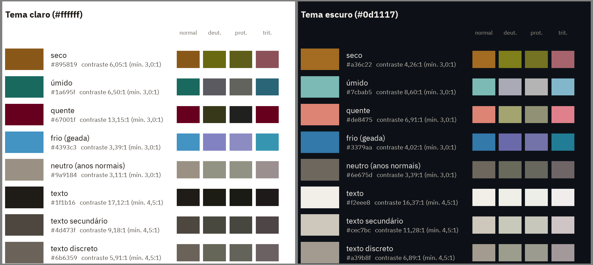

# Decisões de engenharia

Este documento registra as decisões técnicas do pipeline do Atlas da Lavoura, cada uma com as alternativas descartadas e o motivo, para que possam ser defendidas e revistas. O critério para uma decisão entrar aqui é ser algo que uma pessoa técnica questionaria (arquitetura, carga, CI, portabilidade, desempenho, identidade visual). O lado analítico (como os números são calculados) está em [METODOLOGIA.md](METODOLOGIA.md) e a auditoria (validação externa, sensibilidade e correções) em [VALIDACAO.md](VALIDACAO.md).

## Índice

- [Stack do MVP](#stack-do-mvp)
- [Reingestão dos anos mais recentes da PAM](#reingestão-dos-anos-mais-recentes-da-pam)
- [Localidades como snapshot da malha atual](#localidades-como-snapshot-da-malha-atual)
- [Carga da camada raw no Postgres](#carga-da-camada-raw-no-postgres)
- [CI com amostra dos dados](#ci-com-amostra-dos-dados)
- [Clima: BR-DWGD agregado por município](#clima-br-dwgd-agregado-por-município)
- [SQL portável no dbt: um código para Postgres e BigQuery](#sql-portável-no-dbt-um-código-para-postgres-e-bigquery)
- [Nested loop desligado no modelo de janelas climáticas](#nested-loop-desligado-no-modelo-de-janelas-climáticas)
- [Identidade visual](#identidade-visual)
- [BigQuery em produção: sandbox e arquitetura enxuta](#bigquery-em-produção-sandbox-e-arquitetura-enxuta)
- [Operação do BigQuery: recarga e consumo de cota](#operação-do-bigquery-recarga-e-consumo-de-cota)
- [Camada de servir dados: arquivos estáticos para o site](#camada-de-servir-dados-arquivos-estáticos-para-o-site)

## Stack do MVP

A ingestão é feita em Python 3.12, com ambiente e dependências gerenciados pelo uv. Os dados brutos das APIs são salvos primeiro em arquivos Parquet (camada raw) e só depois carregados em um PostgreSQL local, rodando em Docker, que funciona como warehouse de desenvolvimento. As transformações até o modelo dimensional ficam no dbt-core. A camada raw em arquivo permite reprocessar e auditar os dados sem chamar as APIs de novo, e deixa a carga idempotente. O Parquet foi escolhido por preservar os tipos e ocupar pouco espaço.

Alternativas descartadas. DuckDB é mais simples, mas o PostgreSQL tem conexão nativa com o Power BI e fica mais próximo de um warehouse real, o que facilita a migração futura para cloud. pip e Poetry perderam para o uv, que reúne lockfile, gestão da versão do Python e muito mais velocidade numa única ferramenta. Gravar com pandas direto no banco, sem camada raw, acoplaria extração e carga e obrigaria a baixar tudo de novo das APIs a cada erro ou mudança de schema. CSV foi descartado por não preservar tipos. SQL avulso no lugar do dbt perderia a linhagem, os testes de dados e a documentação que o dbt já oferece.

## Reingestão dos anos mais recentes da PAM

A ingestão da PAM é idempotente: cada combinação de cultura e ano vira uma partição Parquet, e partições já existentes são puladas. A exceção são os 2 anos mais recentes disponíveis, que são sempre baixados de novo e sobrescritos. O IBGE revisa os dados da PAM depois da primeira divulgação, então pular esses anos congelaria números preliminares. O "ano mais recente" vem da API de metadados do IBGE a cada execução, e não de um valor fixo no código. Existe também a opção `--force`, que baixa tudo de novo.

Alternativas descartadas. Pular toda partição existente deixaria a camada raw desatualizada sem nenhum aviso. Baixar tudo a cada execução garante dados atualizados, mas custa 184 requisições (de 30 a 60 minutos) para mudar, na prática, só os anos recentes. Comparar hashes do conteúdo exigiria baixar os dados de qualquer forma, então não economizaria requisições.

## Localidades como snapshot da malha atual

A lista de municípios, com UF, região, mesorregião/microrregião e região intermediária/imediata, é baixada da API de Localidades do IBGE como uma foto da malha territorial atual. Cada execução substitui a anterior, sem guardar versões. Isso funciona porque a PAM também publica toda a série histórica na malha atual (municípios criados depois aparecem como "..." nos anos anteriores), então os dois lados do cruzamento usam a mesma referência territorial.

Alternativas descartadas. Guardar um histórico da malha (dimensão de mudança lenta, tipo 2) só teria valor se os fatos viessem em malhas diferentes a cada ano, o que não acontece aqui. O custo é que, se o IBGE redesenhar uma divisão regional, a mudança vale retroativamente para toda a série. Para acompanhar a evolução da malha seria preciso ingerir as tabelas de alterações territoriais do IBGE, o que foge do escopo do MVP.

## Carga da camada raw no Postgres

Cada arquivo Parquet é carregado no schema `raw` com `COPY`, numa transação própria. Na PAM, a transação apaga as linhas daquela partição (cultura e ano) e copia o arquivo. Em Localidades e IPCA, a tabela é esvaziada e recarregada. Se a carga falhar no meio, a transação é desfeita e o banco continua com a versão anterior completa. Para não recarregar 5 milhões de linhas a cada execução, o `_ingested_at` de cada arquivo é comparado com o que já está no banco, e só os arquivos reingeridos desde a última carga são recarregados; `--force` recarrega tudo. Linhas de arquivos que não existem mais no disco geram um aviso na carga e só são apagadas com `--prune`, para que um arquivo removido por engano não apague dados do banco em silêncio. As tabelas raw não têm índices, chaves nem tipagem: isso é papel do dbt.

Alternativas descartadas. `pandas.to_sql` e inserts linha a linha são uma ou duas ordens de grandeza mais lentos que `COPY` e, no caso do pandas, trariam uma dependência só para isso. Um índice em `_source_file` aceleraria o `DELETE` por partição, mas a raw deve ficar sem índices, e com a carga pulando arquivos inalterados o `DELETE` só roda nas poucas partições que mudaram. Comparar hashes do conteúdo seria mais preciso do que comparar `_ingested_at`, mas exigiria ler cada arquivo inteiro a cada execução, e o `_ingested_at` já muda exatamente quando a ingestão regrava um arquivo.

## CI com amostra dos dados

O CI (GitHub Actions) roda em pull requests e em push na `main`, em dois jobs. O primeiro roda o ruff e o pytest. O segundo sobe um PostgreSQL descartável como service container, carrega uma amostra da camada raw com o carregador real (`load-raw`) e roda o `dbt build` completo, com todos os modelos e testes. A amostra fica versionada em `tests/fixtures/raw/`, no mesmo formato de `data/raw/`, e é regerada a partir dos dados reais por `scripts/make_ci_sample.py`. Ela tem a PAM completa (todas as culturas e anos) de 7 municípios escolhidos para cobrir os casos que os modelos precisam tratar: Sorriso-MT, Patrocínio-MG (arábica e bienalidade), Boa Esperança do Norte-MT (sem microrregião, dado só em 2025), Areias-SP (um dos rendimentos de 1998 publicados como "-"), Cascavel-PR, Luís Eduardo Magalhães-BA (desmembrado em 2000) e Cacoal-RO (café canephora). Localidades e IPCA vão completos, porque são pequenos.

Todos os testes do dbt rodam no CI sem exceção, porque foram escritos como invariantes (regras que valem para qualquer subconjunto dos dados): unicidade do grão, relações entre fato e dimensões, a decomposição que fecha, participações que somam 100%, arábica mais canephora igual ao total. Nenhum teste compara com um total nacional publicado, que só valeria com os dados completos. O teste de rendimento com severidade `warn` aparece no CI com 1 caso (Areias-SP em 1998), o que também confirma que o caminho de aviso continua funcionando. Os números da amostra (participações, concentração) não têm significado analítico: o CI verifica que o pipeline funciona e que as regras se mantêm, não os resultados.

As actions do workflow são fixadas pelo SHA do commit da release, com a versão num comentário ao lado (por exemplo, `actions/checkout@3d3c42e… # v7.0.1`), e não por uma tag como `v7`. Tags no Git podem ser movidas para outro commit, de propósito ou por um ataque à conta de quem mantém a action; um SHA não pode. Assim, o código que roda no CI é exatamente o que foi revisado, e uma atualização de versão é sempre uma mudança explícita no workflow. As versões e os SHAs foram conferidos nas tags publicadas de cada repositório. Isso também evita um problema real: nem toda action publica uma tag de versão major (o `astral-sh/setup-uv` só publica tags completas, como `v10.2.0`). Para que os SHAs não fiquem velhos, o Dependabot (`.github/dependabot.yml`) verifica as actions toda semana e abre um PR que atualiza o SHA e o comentário de versão juntos, passando pelo CI antes do merge.
**CI com a amostra.** Com clima de 2023 a 2025 para 7 municípios, só as colheitas de 2024 e 2025 têm janelas completas; a de 2023 fica com cobertura parcial e indicadores nulos, o que exercita a regra de completude. A normal de 1991–2020 não existe na amostra, então os z-scores ficam nulos e `is_normal_available` é falso; a tendência de rendimento existe, porque a PAM da amostra é completa. Todos os testes são invariantes condicionados a essas flags, e os de eventos conhecidos passam vazios. Nenhum modelo ou teste fica fora do CI.
Alternativas descartadas. Baixar os dados reais das APIs a cada execução do CI deixaria o build lento (cerca de 25 minutos só para a PAM) e dependente da disponibilidade do IBGE e do BCB. Criar dados sintéticos à mão testaria só os casos imaginados, enquanto a amostra real traz as esquisitices da fonte. Pular os testes que "precisam de dados completos" não foi necessário, porque nenhum precisa.

## Clima: BR-DWGD agregado por município

Os dados climáticos vêm do **BR-DWGD** (Brazilian Daily Weather Gridded Data), **versão v3.2.4** (grafada `v_3.2.4` nos nomes dos arquivos da fonte, e assim registrada na coluna `_source_version` dos Parquet), uma grade diária de 0,1° × 0,1° (cerca de 11 km) interpolada a partir de estações meteorológicas e pluviômetros de todo o país. São usadas quatro variáveis: chuva, temperatura máxima, temperatura mínima e evapotranspiração de referência (ETo), de 1980 a 2025. A página e o repositório do autor pedem a citação abaixo e não declaram uma licença; o catálogo comunitário do Google Earth Engine lista os dados sob CC BY 4.0.

> Xavier, A. C., Scanlon, B. R., King, C. W., & Alves, A. I. (2022). New improved Brazilian daily weather gridded data (1961–2020). *International Journal of Climatology*, 42(16), 8390–8404. https://doi.org/10.1002/joc.7731

Cada município recebe a média das células cujo centro cai dentro do seu polígono, pela malha municipal do IBGE (qualidade máxima). Quando nenhum centro cai dentro, o que acontece com municípios pequenos, usa-se a célula que contém o ponto representativo do polígono (um ponto que sempre fica dentro dele). Se essa célula não tem dado, porque cai no mar, usa-se a célula com dado mais próxima, até 0,2°; mais longe que isso, o município fica sem dado. Na malha atual, 5.304 municípios usam células internas, 259 o ponto representativo, 7 municípios litorâneos a célula vizinha e 1 fica sem dado (Fernando de Noronha, fora da grade). O método de cada município fica registrado em `raw.brdwgd_municipality_cells`. Os arquivos NetCDF não são baixados inteiros: o índice dos zips no Google Drive é lido com requisições HTTP Range, e só as quatro variáveis usadas são extraídas (8,5 GB baixados em vez de 9,9 GB).

Para a ingestão ser reprodutível, o SHA-256 de cada um dos 12 arquivos NetCDF usados fica versionado em `checksums/brdwgd_v3.2.4.sha256`, no formato do `sha256sum`. Cada arquivo é conferido contra esse manifesto ao ser baixado (antes de receber o nome final) e antes de ser lido pela agregação; se algum hash não bater, ou se aparecer um arquivo que não está no manifesto, a ingestão falha. Assim, uma republicação silenciosa da grade pelo autor não entra nos dados sem ser notada, e adotar uma versão nova é uma mudança explícita: novo manifesto e nova versão.

**Download manual, se a leitura parcial do zip parar de funcionar.** O download automático depende de o Google Drive aceitar requisições HTTP Range no link direto dos zips. Se isso mudar:

1. Baixe pelo navegador, na [pasta oficial do BR-DWGD no Google Drive](https://drive.google.com/drive/folders/11-qnvwojirAtaQxSE03N0_SUrbcsz44N), os arquivos `pr_Tmax_Tmin_NetCDF_Files.zip` (7,7 GB) e `ETo_u2_RH_Rs_NetCDF_Files.zip` (2,2 GB). A [página do autor](https://sites.google.com/site/alexandrecandidoxavierufes/brazilian-daily-weather-gridded-data) também aponta uma cópia dos NetCDF sem compressão no Dropbox e no Google Earth Engine.
2. Extraia só os 12 arquivos listados em `checksums/brdwgd_v3.2.4.sha256` (variáveis `pr`, `Tmax`, `Tmin` e `ETo`, três períodos cada) para `data/external/brdwgd/`. Por exemplo: `unzip -j pr_Tmax_Tmin_NetCDF_Files.zip 'pr_*' 'Tmax_*' 'Tmin_*' -d data/external/brdwgd/` e `unzip -j ETo_u2_RH_Rs_NetCDF_Files.zip 'ETo_*' -d data/external/brdwgd/`.
3. Confira os hashes: `(cd data/external/brdwgd && sha256sum -c ../../../checksums/brdwgd_v3.2.4.sha256)`.
4. Rode a agregação sem baixar: `uv run ingest-brdwgd --skip-download`. Os hashes são conferidos de novo antes da leitura.

A tabela município × dia (93,6 milhões de linhas) é uma exceção à regra de manter a camada raw em texto: suas colunas são tipadas (inteiro, data e real) no Parquet e no Postgres. Ela não é uma cópia do que a fonte entregou, e sim o resultado de uma agregação espacial feita pelo projeto, então não há um "texto original" a preservar, e guardar números como texto multiplicaria o tamanho sem ganho de auditoria. No Postgres, a tabela usa particionamento nativo por ano (uma partição por arquivo anual). Recarregar um ano é um `TRUNCATE` da partição seguido de `COPY`, numa transação, e leva cerca de 4 segundos, contra minutos de um `DELETE` numa tabela desse tamanho. Os metadados de carga (`_ingested_at`, arquivo de origem, horário da carga) ficam uma vez por arquivo na tabela de controle `raw._load_manifest`, em vez de repetidos em cada linha, o que economizaria vários gigabytes.

Alternativas descartadas. As estações do INMET dão o dado medido, sem interpolação, mas são esparsas justamente onde a produção se concentra (51 estações automáticas operantes para o Mato Grosso, com 29% da soja), começam em 2000 e mudam de formato em 2019. O ERA5-Land tem a mesma resolução, mas é uma reanálise de modelo, com viés conhecido de chuva nos trópicos, e exige conta no Copernicus. O NASA POWER tem uma API simples, mas uma célula de 0,5° × 0,625° (cerca de 55 × 70 km) é grossa demais para municípios. A média ponderada pela área de interseção de cada célula com o polígono seria um pouco mais precisa que "centro dentro do polígono", mas exigiria bibliotecas geoespaciais pesadas (GDAL), com ganho pequeno numa grade de 0,1°.

As limitações da grade interpolada para a análise (suavização de extremos, densidade variável de estações, média por município) estão em [METODOLOGIA.md](METODOLOGIA.md#limitações-dos-dados-climáticos-em-grade).

## SQL portável no dbt: um código para Postgres e BigQuery

A partir da fase 10 o projeto roda em dois warehouses: o PostgreSQL local continua como ambiente de desenvolvimento e de CI, e o BigQuery passa a ser a produção. Os modelos do dbt são um só código para os dois, escrito no SQL que os dois dialetos compartilham mais as macros cross-database do próprio dbt (`type_int`, `type_string`, `bool_or`, `except`, `datediff`, `last_day`, `date_trunc`; `generate_series` do dbt_utils) e quatro macros próprias em `dbt/macros/cross_database.sql`, que escolhem a forma certa pelo adapter (`adapter.dispatch`): `source_column` (nome de coluna da raw: entre aspas no Postgres, onde os nomes das APIs são case-sensitive e têm hífen; no BigQuery, que não aceita hífen, o hífen vira `_`, o mesmo rename que o carregador fará), `regex_match` (`~` ou `REGEXP_CONTAINS`), `parse_date` (`to_date` ou `PARSE_DATE`, com formato em notação `%d/%m/%Y`) e `date_from_parts` (`make_date` ou `DATE(ano, mês, dia)`; a macro `dbt.date()` só aceita literais).

As trocas foram mecânicas, mas algumas merecem registro. `filter (where ...)` virou `case when` dentro das agregações, que é equivalente e universal. A inclinação da tendência de rendimento deixou de usar `regr_slope`/`regr_intercept` (que o BigQuery não tem) e passou a `covar_pop(ln y, ano) ÷ var_pop(ano)`, com a reta avaliada em torno das médias; é a mesma reta, com diferença apenas no último dígito de ponto flutuante. `generate_series(a, b)` com limites vindos de uma consulta virou o `generate_series(n)` do dbt_utils (uma série fixa de números, montada por `union all` e `cross join`) recortada pelos limites, com cast de volta para inteiro, porque a série do dbt_utils sai como ponto flutuante. Os dias de cada mês, antes `make_date(...) + interval '1 month - 1 day'`, agora são `extract(day from last_day(...))`. A técnica de gaps-and-islands, que subtraía um número de uma data, passou a subtrair de um número de dias desde 1970-01-01, para não depender de aritmética de datas. `unnest(array[...])` virou `union all` de literais gerado pelo Jinja. `%` virou `mod()` e a divisão inteira `ano / 10 * 10` virou `div(ano, 10) * 10`, porque no BigQuery `/` entre inteiros devolve ponto flutuante. O `pre_hook` que aumenta o `work_mem` do Postgres só é emitido quando `target.type` é `postgres`. Os casts para numérico usam `numeric` literal, e não `dbt.type_numeric()`, porque no Postgres essa macro vira `numeric(28,6)`, o que mudaria a escala das divisões e, com ela, os últimos dígitos de rendimentos e participações; `numeric` sem precisão existe nos dois dialetos. Os `+column_types` dos seeds (`integer`, `numeric`) também são aceitos pelos dois.

**Validação do porte.** Antes de mudar qualquer modelo, as 18 tabelas dos schemas `marts`, `intermediate` e `staging` foram copiadas para um schema de referência; depois do `dbt build` completo com o SQL portável, cada tabela foi comparada com a cópia linha a linha, nos dois sentidos (`except all`), pelo script `scripts/compare_dbt_baseline.sql`. Treze tabelas são idênticas byte a byte, entre elas o fato de produção (925.986 linhas), o pivô da PAM (1.023.776), os indicadores de janela (350.280) e todos os agregados de produção. As outras cinco (`int_climate__window_normals`, `fct_crop_climate`, `int_yield__territory_trend`, `agg_climate_yield_association` e o seu `_summary`) têm as mesmas linhas no mesmo grão, nenhuma diferença em colunas inteiras, de texto ou booleanas (as classes de estresse não mudam), e diferenças só no último dígito de ponto flutuante: no máximo 1e-14 relativo nas normais e nos z-scores, e 1e-9 na anomalia de rendimento, que é uma razão próxima de zero. Duas causas, ambas esperadas: médias e desvios de `double precision` dependem da ordem física das linhas, que mudou com o plano de execução, e a inclinação da tendência passou de `regr_slope` para `covar_pop ÷ var_pop`. O projeto também foi compilado para o BigQuery sem conta nenhuma, com o adapter instalado de forma temporária e uma chave de service account falsa gerada localmente: isso confere que as macros renderizam SQL do dialeto certo, não que o BigQuery o aceita. A execução real no BigQuery veio na fase 10b (ver [BigQuery em produção](#bigquery-em-produção-sandbox-e-arquitetura-enxuta)), e achou um erro de dialeto e uma diferença de precisão que a compilação não pega.

Alternativas descartadas. Manter dois conjuntos de SQL (um por warehouse, com `` em cada modelo) duplicaria regras e testes e deixaria os dois divergirem com o tempo. Ficar só no Postgres e levar o próprio Postgres para a cloud (Cloud SQL, AlloyDB) evitaria o porte, mas esses serviços não têm camada gratuita permanente e o objetivo da fase é justamente operar um warehouse colunar. Transpilar o SQL no build com uma ferramenta como o sqlglot esconderia as diferenças de dialeto de quem lê o código e acrescentaria uma dependência no caminho crítico do build.

## Nested loop desligado no modelo de janelas climáticas

O modelo `int_climate__window_indicators` tem, no Postgres, um segundo `pre_hook` além do `work_mem`: `set enable_nestloop = off`, válido só para a sessão daquele `CREATE TABLE`. A causa raiz é uma estimativa de cardinalidade errada: o planejador não tem estatísticas sobre a CTE `assigned` (cada dia de cada município produtor atribuído às janelas que contêm o seu mês) e estima o cruzamento `producing × calendar` em 87 linhas, quando são 40.320; a CTE inteira é estimada em 22 mil linhas, contra 55 milhões reais, e o resultado final em 1 linha, contra 350 mil. Com estimativas assim, o último join do modelo (as duas agregações da CTE, a dos indicadores e a do maior veranico) parece caber num nested loop, que varre uma tabela hash de 350 mil entradas uma vez por linha externa: mais de uma hora, contra cerca de 4 minutos com o hash join. O plano com hash join era o escolhido até o porte da fase 10a; a troca de `generate_series` pela série do dbt_utils mudou a estimativa de uma CTE pequena em 0,07% do custo total e bastou para o planejador mudar de ideia.

O ajuste de sessão contorna o sintoma: com nested loops desligados, o planejador volta aos hash joins em todos os joins do modelo, e os nested loops só ficam onde são a única opção (a série de números e o `cross join` com a CTE de uma linha). Ele não corrige a estimativa, que continua errada, e por isso é restrito a este modelo e a este banco, com o motivo em comentário no próprio modelo. Não é uma prática geral: desligar o nested loop num banco inteiro, ou por hábito, troca um plano ruim aqui por planos ruins em consultas pequenas, onde o nested loop é o certo. As alternativas seriam reescrever o modelo sem o join (união das duas agregações e `group by`), que não protegeria o join seguinte, ou criar estatísticas estendidas, que o Postgres não tem para junções entre tabelas.

## Identidade visual

**Base.** As cores dos dados seguem o guia visual do IPCC para o AR6 ([IPCC AR6 WGI Visual Style Guide, 2022](https://www.ipcc.ch/site/assets/uploads/2022/09/IPCC_AR6_WGI_VisualStyleGuide_2022.pdf)) e as escalas oficiais publicadas pelo próprio grupo de trabalho no repositório [IPCC-WG1/colormaps](https://github.com/IPCC-WG1/colormaps). O guia associa tons marrom-amarelados à seca, o azul à água e ao frio e o vermelho ao calor (página 10 do PDF). Ele também pede escalas divergentes de dois matizes com o centro claro e desaconselha usar azul com roxo ou verde com vermelho quando um gráfico tem mais de uma escala (página 12). Para chuva e balanço hídrico, indica a escala divergente `prec_div`, do marrom ao verde-azulado; para temperatura, a `temp_div`, do azul ao vermelho, as duas do ColorBrewer (página 13). A seca é a cor principal do projeto. O repositório do IPCC não declara licença; as duas escalas são de Brewer, Harrower e Penn State (2002), creditados no guia, e o projeto usa os valores de cor com essa atribuição.

**Paleta.** Cada papel tem uma variante para o fundo claro do GitHub (#ffffff) e outra para o escuro (#0d1117), sempre tiradas da mesma escala oficial: um dos 11 passos discretos ou uma posição da escala contínua de 256 tons (índice 0 a 255 nos arquivos `prec_div.txt` e `temp_div.txt`).

| Papel | Claro | Contraste | Escuro | Contraste | Origem |
|---|---|---|---|---|---|
| Seco (cor principal) | `#895819` | 6,05:1 | `#a36c22` | 4,26:1 | `prec_div`, passo 2 de 11 (contínua 26) e contínua 38 |
| Úmido | `#1a695f` | 6,50:1 | `#7cbab5` | 8,60:1 | `prec_div`, passo 10 de 11 (contínua 229) e contínua 176 |
| Quente | `#67001f` | 13,15:1 | `#de8475` | 6,91:1 | `temp_div`, passo 11 de 11 (contínua 255) e contínua 186 |
| Frio (geada) | `#4393c3` | 3,39:1 | `#3379aa` | 4,02:1 | `temp_div`, passo 3 de 11 (contínua 51) e contínua 38 |
| Neutro (anos normais) | `#9a9184` | 3,11:1 | `#6e675d` | 3,39:1 | cinza quente do projeto |
| Texto | `#1f1b16` | 17,12:1 | `#f2eee8` | 16,37:1 | quase preto e quase branco quentes |
| Texto secundário | `#4d473f` | 9,18:1 | `#cec7bc` | 11,28:1 | eixos e legendas |
| Texto discreto | `#6b6359` | 5,91:1 | `#a39b8f` | 6,89:1 | rodapé, fontes e linha do zero |

**Como as variantes foram escolhidas.** A primeira tentativa, com os passos mais saturados das escalas de 11 tons nos dois temas, passava nos pares exigidos, mas falhava em três outros: úmido e frio ficavam quase iguais na tritanopia (distância 2,0), úmido e neutro na protanopia (4,3), e seco e quente na deuteranopia do tema escuro (6,8). Seca e calor são classes do mesmo mart e podem aparecer juntas num gráfico do dashboard, então a escolha final saiu de uma busca exaustiva ao longo das escalas oficiais. Entre as combinações com pelo menos 3:1 de contraste no fundo, ficou a que maximiza a menor distância entre todos os pares de cores de dados, com e sem simulação; no escuro, entre as que passam em todos os pares, a que mais separa seco de neutro, o par do gráfico principal. O seco e o quente se diferenciam pelo eixo vermelho-verde, justamente o que a protanopia e a deuteranopia perdem, então só a claridade os separa. Por isso o quente do tema claro é o extremo da escala (#67001f, bem mais escuro que o seco) e o do escuro é um salmão claro (#de8475). O neutro é um cinza quente próprio, porque o centro das escalas do IPCC é quase branco: é o tom mais discreto que ainda tem 3:1 de contraste.

**Sem cor de destaque.** Uma versão anterior tinha um roxo para os títulos, escolhido por ficar longe das cores de dados. Ele foi descartado: era a única cor sem função no contexto do projeto e destoava da paleta terrosa. A paleta fica restrita a cores com função, as que codificam uma classe climática e as de texto. O título usa a cor principal do texto de cada tema, e o destaque visual fica só com os dados (o marrom da seca) e com o peso da fonte (o 73% em negrito no subtítulo).

**Validação.** O contraste segue a fórmula de luminância relativa do WCAG 2.x: 4,5:1 para texto, 3:1 para as cores de dados (critério 1.4.11, objetos gráficos). A grade é decorativa e fica de fora. O daltonismo é simulado com a biblioteca daltonlens (0.1.5), usando o modelo de Viénot (1999) para protanopia e deuteranopia e o de Brettel (1997) para tritanopia, com severidade total, como a própria biblioteca recomenda. A distância entre duas cores é medida em CAM02-UCS com a colorspacious (1.1.2), um espaço feito para que distâncias iguais pareçam diferenças iguais. O limiar do projeto é de 15 unidades, com visão normal e em cada simulação, para todos os pares de cores de dados. Diferenças de poucas unidades já se percebem lado a lado em áreas grandes, e a folga é para marcas pequenas, como os pontos de 2 a 3 px do gráfico do README. Os pares exigidos ficaram assim: seco contra neutro com 23,0 no tema claro e 16,9 no escuro; quente contra frio com 48,2 e 30,3. O pior par de todos é seco contra quente no tema escuro, com 15,8 na tritanopia. O script `scripts/check_visual_identity.py` refaz todas as medidas, falha se algum limite for violado e gera a amostra acima e a simulação do gráfico do README (`docs/img/identity_cvd_chart.png`); um teste do pytest roda a mesma verificação no CI. A simulação é um modelo de dicromacia completa, e cada pessoa tem um grau próprio, por isso a regra de uso abaixo de nunca depender só da cor.

**Tipografia.** A fonte é a [IBM Plex Sans](https://github.com/IBM/plex) (IBM, versão 3.005, licença SIL Open Font License 1.1), nos arquivos estáticos regular e negrito publicados pela própria IBM no repositório oficial. A escolha saiu da comparação de três fontes abertas, todas em versões estáticas (um arquivo por peso) obtidas nos repositórios dos autores: Source Sans 3 (Adobe, `adobe-fonts/source-sans`), IBM Plex Sans (`IBM/plex`) e Inter (`rsms/inter`). As três têm todos os caracteres usados nos gráficos (acentos do português, sinal de menos, ≤, ×, ° e travessão), o zero sem traço, e o matplotlib seleciona corretamente o arquivo negrito de cada uma quando os dois pesos são registrados. A Plex é a que melhor separa os caracteres que se confundem em tamanho pequeno: o I maiúsculo tem barras em cima e embaixo e o l minúsculo tem cauda, enquanto na Inter o I e o l são idênticos. Ela também tem altura do x de 0,516 em, contra 0,486 na Source Sans 3, então o texto pequeno fica maior na mesma medida em pontos. A Inter tem a maior altura do x (0,546 em), mas é a mais larga e repete a ambiguidade do I e do l. Os arquivos ficam versionados em `src/atlas_da_lavoura/viz/fonts/`, com a licença, e são registrados no matplotlib quando o gráfico é gerado, então ele sai igual em qualquer máquina e no CI, sem instalar fonte no sistema. Alternativas descartadas: a Atkinson Hyperlegible (Braille Institute), usada numa primeira versão, distingue bem os caracteres, mas o zero com traço interno deixava anos e percentuais com aparência de defeito ("2ØØ5", "−2Ø"); Arial e Frutiger, recomendadas pelo IPCC, são proprietárias; as versões variáveis das três candidatas, as únicas no Google Fonts, não servem porque o matplotlib usa só a instância padrão e não seleciona o negrito; a DejaVu Sans, padrão do matplotlib, é larga e não distingue I de l.

**Uma fonte única para a identidade.** Cores (com papel, variantes e origem), tipografia, escala de tamanhos e o estilo do matplotlib ficam em `src/atlas_da_lavoura/viz/identity.py`. O estilo é gerado a partir das cores (`rc_params`, `apply_style`), e `as_dict()` exporta tudo num dicionário serializável em JSON, base para gerar o tema do Power BI. Alternativa descartada: arquivos `.mplstyle` com as cores escritas à mão, que repetiriam a paleta e deixariam o tema do Power BI sem uma origem comum. A fonte do dashboard será revista na fase do Power BI, porque o serviço tem a sua própria lista de fontes.

**Desvios deliberados do guia do IPCC.** O título do gráfico do README é em negrito, embora o guia peça para evitar negrito: ali o gráfico funciona como manchete, não como figura de relatório. Os eixos não são pretos no tema escuro, onde preto não teria contraste. O neutro não vem das escalas do IPCC.

**Regras de uso.** O seco é a cor da seca e de nada mais, e os anos normais são sempre o neutro. Cada gráfico destaca uma classe de cada vez contra o neutro; quando duas classes aparecem juntas, a diferença também vem da legenda, de rótulos diretos ou da posição, nunca só da cor.

## BigQuery em produção: sandbox e arquitetura enxuta

**O que roda onde.** O PostgreSQL local continua sendo o ambiente de desenvolvimento e o banco do CI, e é o único que guarda o clima diário (93,6 milhões de linhas). O BigQuery é o warehouse de produção: projeto `atlas-da-lavoura`, região `southamerica-east1`, no modo sandbox. Ele recebe a PAM, as Localidades, o IPCA, o mapa de células e os indicadores climáticos por janela já calculados no Postgres, e o dbt constrói ali todos os modelos a partir deles. O produto não lê o warehouse: o site vai ler arquivos pequenos e pré-agregados, gerados pela camada de servir dados e publicados numa CDN. Por isso o warehouse pode ficar vazio ou expirar sem que nada saia do ar, e ele só precisa existir no momento de publicar dados novos.

**Por que o clima diário não sobe.** O clima diário tem cerca de 4,5 GB lógicos, e a única etapa que o lê é o cálculo dos indicadores por janela (`int_climate__window_indicators`). Esse cálculo roda uma vez no Postgres, e só o resultado, com 350 mil linhas e 67 MiB, sobe para o BigQuery como uma fonte derivada. Os outros modelos do clima (normais, fato de clima, associação com o rendimento) são construídos no BigQuery a partir dela.

**Limites do sandbox.** Conforme a [documentação oficial](https://docs.cloud.google.com/bigquery/docs/sandbox), consultada em 2026-11-06:
- **Armazenamento:** limite vitalício de 10 GiB, e a cota não é devolvida quando os dados são apagados. Cada carga e cada reconstrução de tabela consomem cota de forma cumulativa, por isso o desenvolvimento e os testes ficam no Postgres, e o BigQuery recebe carga e build só quando há dados novos a publicar.
- **Consultas:** 1 TiB processado por mês. Um build completo lê poucos GB.
- **Expiração:** tabelas, views e partições expiram em 60 dias.
- **Proibido:** DML (INSERT, UPDATE, DELETE, MERGE), streaming e Data Transfer Service.

O que o projeto precisa foi testado na prática, num dataset descartável: load job de Parquet com substituição da tabela, `create or replace table … as select`, `create or replace view` e `alter table … set options` funcionam; INSERT e DELETE são recusados. O dbt-bigquery cria tabelas, views e seeds exatamente com essas operações, e o projeto só usa materializações `table` e `view`, sem `incremental` nem `snapshot`.

**O dbt igual nos dois bancos.** A macro `use_derived_climate_source()` (em `dbt/macros/warehouse_layout.sql`) é verdadeira no BigQuery e falsa no Postgres. Quando verdadeira, `int_climate__window_indicators` vira uma view sobre a fonte `raw.climate_window_indicators`, com as mesmas colunas e tipos, e o modelo e a fonte do clima diário e o teste de virada de ano, que leem o dado diário, ficam desligados. Todo o resto do projeto continua fazendo `ref` do mesmo modelo e não muda. A macro também lê uma variável, para que o mesmo caminho rode no Postgres: o CI exporta os indicadores, carrega a fonte derivada e reconstrói o projeto nesse modo, com todos os testes. Alternativas descartadas: manter modelos separados para produção duplicaria regras e testes; fazer cada modelo seguinte escolher entre `ref` e `source` espalharia a condição; materializar a fonte derivada como tabela no BigQuery gastaria 67 MiB de cota a cada build sem ganho, porque a view só repassa a tabela raw.

**A raw no BigQuery.** Sem DML, cada fonte vira uma tabela substituída inteira por um único load job (`WRITE_TRUNCATE`), o que é atômico: uma falha no meio deixa a versão anterior. Os nomes de coluna com hífen recebem `_`, a mesma troca que a macro `source_column` faz no SQL. A coluna `_source_url` é a mesma URL em todas as linhas de um arquivo e respondia por 39% do tamanho da PAM, então no BigQuery ela fica uma vez por arquivo na tabela de controle `raw._load_manifest`, junto com a data de ingestão e o número de linhas. Ficam em cada linha só os metadados que o staging lê (`_ingested_at` e `_loaded_at`), e com isso o dbt é o mesmo nos dois bancos. A carga compara a data de ingestão de cada arquivo com o manifesto e só recarrega uma tabela quando algum arquivo mudou ou quando a tabela não existe mais (expirou). O Postgres mantém o desenho atual de propósito: lá a carga substitui um arquivo de cada vez e usa `_source_file` em cada linha para apagar e recarregar só aquela partição da PAM e para detectar dados de arquivos removidos; o Postgres não tem cota vitalícia, e os 470 MB a mais no disco local não pesam. A diferença fica restrita aos metadados de carga, que nenhum modelo lê.

**Razões, logaritmos e exponenciais em ponto flutuante.** O primeiro build real no BigQuery falhou em dois testes que passam no Postgres: as participações por território não somavam 1 e a decomposição área × rendimento não fechava, ambas com tolerância de 1e-9. No BigQuery, a divisão entre dois NUMERIC devolve um NUMERIC arredondado a 9 casas decimais, e `LN` e `EXP` de um NUMERIC também; no Postgres o `numeric` guarda cerca de 20 dígitos. Somadas sobre centenas de regiões, as participações arredondadas chegavam a 3e-7 de erro. A regra adotada vale para os dois bancos: razões, logaritmos e exponenciais são calculados em ponto flutuante (macro `as_float()`), e o NUMERIC fica para as quantidades medidas (toneladas, hectares, valor nominal). Isso alcançou os rendimentos, as participações, o HHI, a decomposição, a bienalidade do café, a tendência log-linear, o índice encadeado do IPCA e as taxas de acerto. No Postgres, a comparação de todas as tabelas antes e depois da mudança mostrou só diferenças no último dígito, e nenhuma coluna de texto, inteira ou booleana mudou, então as classes e os resultados publicados são os mesmos. Alternativa descartada: afrouxar a tolerância dos testes só no BigQuery esconderia a perda de precisão em vez de removê-la.

**Trava de segurança.** Toda escrita no BigQuery passa por uma confirmação explícita. O `load-raw --target bigquery` e o `bq-dbt build` mostram antes a estimativa do que vão gravar, em bytes lógicos pelas regras do BigQuery, ao lado do que o registro de cota diz que já foi usado. Só escrevem depois de um "yes" digitado ou da flag `--yes`. No dbt, um hook `on-run-start` recusa `run`, `build`, `seed` e `snapshot` num target BigQuery que não venha do `bq-dbt`; o dbt cria os datasets vazios antes do hook, o que não ocupa armazenamento. Depois de cada escrita, o tamanho lógico do que foi gravado é medido e acrescentado a `docs/bigquery_quota_log.csv`. Essa é a melhor medida disponível, porque o consumo da cota em si não é exposto.

**Validação.** O primeiro ciclo foi feito com tabelas vazias: `load-raw --empty` e `bq-dbt build --empty` rodaram todo o SQL do projeto no BigQuery a custo zero de cota e acharam um erro de dialeto (um teste com `WHERE` sem `FROM`, que o Postgres aceita e o BigQuery não), corrigido com uma subconsulta de uma linha. Antes disso, o desenho do BigQuery foi montado num Postgres descartável com os dados completos, sem clima diário e com a fonte derivada: todos os testes passaram, e as tabelas ficaram idênticas às do banco de desenvolvimento, com diferenças só no último dígito de ponto flutuante. Depois do ciclo real, o script `scripts/compare_postgres_bigquery.py` comparou os dois bancos tabela a tabela, pela chave de cada uma: as 18 tabelas e views de modelos e os 7 seeds têm as mesmas contagens; produção e área são idênticas, inclusive nos totais do Brasil dos 184 pares de cultura e ano; texto, inteiros e booleanos, incluindo todas as classes de seca, calor e geada, são idênticos; os números de ponto flutuante diferem no máximo 7e-10 relativo, nas anomalias de rendimento perto de zero (rendimento ÷ tendência − 1), onde a diferença absoluta é da ordem de 1e-15. Todos os testes do dbt passam no BigQuery, com os mesmos três avisos esperados do Postgres.

## Operação do BigQuery: recarga e consumo de cota

**Quando operar.** Só quando há dados novos a publicar: o ano novo da PAM (setembro), uma atualização do IPCA que se queira publicar, uma versão nova do BR-DWGD ou uma mudança de modelo que altere resultados. Fora disso, o BigQuery fica como está e as tabelas expiram em 60 dias sem afetar o produto.

**Procedimento de recarga.** Do diretório raiz do repositório, com o Postgres local atualizado:
1. Atualizar e validar no Postgres: as ingestões necessárias, `uv run load-raw` e `dbt build`, com todos os testes passando.
2. Exportar os indicadores de janela: `uv run export-window-indicators`.
3. Carregar a raw: `uv run load-raw --target bigquery`. Ele recarrega só as tabelas com arquivo novo ou que expiraram, e mostra a estimativa antes de pedir a confirmação.
4. Se o SQL mudou desde o último ciclo, validar antes sem gastar cota: `uv run bq-dbt build --empty --resource-type model seed`, seguido de `uv run bq-dbt test`. O `--empty` substitui as tabelas por versões vazias, então ele só vale quando o build real vem logo a seguir.
5. Construir os modelos: `uv run bq-dbt build`, ou só os modelos afetados com `--select`, para economizar cota.
6. Validar contra o Postgres: `uv run python scripts/compare_postgres_bigquery.py`.
7. Rodar todos os testes no BigQuery: `uv run bq-dbt test`. O resumo desta execução vai para o `method.json` do site, então ela precisa ser completa e a última antes da exportação.
8. Exportar os arquivos do site: `uv run export-serving --target bigquery --dry-run` mostra os bytes que cada consulta vai processar (cota mensal de consulta, não de armazenamento), e `uv run export-serving --target bigquery` grava `dist/site-data/<versão>/`. Para conferir, exportar também do Postgres (`--target postgres --out dist/site-data-postgres`) e comparar com `uv run python scripts/compare_serving_bundles.py`.
9. Empacotar: `uv run package-serving dist/site-data/<versão>` gera o pacote, as notas do release e o ponteiro `data-release.json`. O release `data-v<versão>` é criado à mão com o comando que ele imprime, depois de revisar, e o ponteiro vai para a `main` num PR.
10. Atualizar a tabela abaixo a partir de `docs/bigquery_quota_log.csv`.

Num Postgres, reconstruir uma tabela sozinha (`dbt build --select <tabela>`) apaga as views que dependem dela, porque o dbt-postgres troca a tabela e remove a anterior com `drop ... cascade`. Reconstruir junto os dependentes (`--select <tabela>+` ou o build completo). O BigQuery não tem esse problema: `create or replace table` mantém as views.

Quando as tabelas expiram, o manifesto expira junto, e a próxima carga recarrega tudo: o procedimento é o mesmo, e custa um ciclo completo.

**Consumo da cota vitalícia** (10.240 MiB por projeto GCP). A cota é do projeto: quando o projeto foi recriado com o nome Atlas da Lavoura, em 2026-11-09, o registro (`docs/bigquery_quota_log.csv`) recomeçou do zero.

| Data | Operação | Gravado | Acumulado | Restante |
|---|---|---|---|---|

Os ciclos do projeto GCP anterior, de 2026-11-06 a 2026-11-08, gravaram 1.350,8 MiB:
- a validação com tabelas vazias, a custo zero;
- a carga completa da raw, 816,8 MiB;
- o `dbt build` completo, 369,3 MiB;
- o rebuild de 10 modelos com as razões em ponto flutuante, 163,8 MiB;
- a camada de servir, 1,0 MiB.

O projeto anterior é encerrado depois da migração, e o consumo dele não conta para a cota do atual.

Um ciclo completo (carga e build) grava cerca de 1.186 MiB, então a cota de um projeto novo comporta cerca de 8 ciclos completos, ou cerca de 27 builds sem recarga da raw. As views da camada de servir não gravam nada; cada exportação só usa cota de consulta (cerca de 440 MiB processados, 0,04% da cota mensal de 1 TiB, que se renova). A carga da PAM, com 749 MiB, é a maior parte de cada ciclo, e só se repete quando a PAM muda ou quando as tabelas expiram.

## Camada de servir dados: arquivos estáticos para o site

**O que é.** O site não consulta o warehouse: ele lê arquivos JSON pequenos e pré-agregados e uma malha em TopoJSON, publicados numa CDN. Os arquivos saem de views `serve_*` (schema `serve`), que leem só marts, dimensões e, na validação, os seeds de referência externa. O comando `export-serving` lê cada view uma única vez, monta os arquivos, simplifica a malha, valida tudo contra os JSON Schemas e as regras de validade, concilia os arquivos com os marts por consultas independentes e só então grava a pasta da versão, com um manifesto. O contrato dos arquivos está em [CONTRATO_DE_DADOS.md](CONTRATO_DE_DADOS.md).

**Views, não tabelas.** No BigQuery, uma view não ocupa a cota vitalícia de armazenamento; o custo passa para a consulta, no momento da exportação. O dry run das consultas da exportação, com a dimensão de municípios recalculada (um limite superior), deu cerca de 510 MiB processados, 0,05% da cota mensal de 1 TiB. Por isso o exportador lê cada view uma vez e reparte os arquivos em Python: uma consulta por município varreria as mesmas tabelas 5.571 vezes. As views expiram com o resto do sandbox, mas a exportação acontece logo depois do build, e o retrato que vale fica nos arquivos. Alternativa descartada: materializar como tabelas, o que gastaria cota a cada build sem ganho.

**Arredondamento nas views.** Cada valor publicado é arredondado no dbt, com casas fixas por tipo: inteiros para toneladas, hectares, kg/ha e mil reais; 4 casas nas frações (participações, anomalias, taxas); 2 nos z-scores; 1 nos percentuais. A macro `round_to` passa o valor por NUMERIC antes de arredondar, para que os dois bancos arredondem o mesmo decimal (o Postgres não tem `round` de ponto flutuante com casas, e o `ROUND` do BigQuery arredondaria o valor binário). O exportador recusa qualquer número de ponto flutuante que chegue sem arredondar. Com isso, os arquivos gerados do Postgres e do BigQuery são iguais, e menores.

**JSON em colunas, comprimido pela CDN.** As tabelas são objetos de arrays de mesmo tamanho, e as matrizes do mapa têm uma linha por município, na ordem do índice. Medido na matriz de produção da soja (5.571 municípios × 52 anos): 188 KiB com gzip em JSON por município, 221 KiB em JSON por ano e 345 KiB em Parquet com zstd, que ainda exigiria uma biblioteca de leitura no navegador. Arredondar a 3 algarismos significativos reduziria só 10% e perderia a exatidão. Alternativas descartadas: Parquet e Arrow (maiores aqui e com dependência no site), arredondamento para o mapa.

**Divisão dos arquivos.**
- **Base:** `catalog.json` (versão, séries, parâmetros, atribuição das fontes), o índice de municípios, `analysis.json` e `method.json`.
- **Explorar:** 24 matrizes, uma por série e medida.
- **Fichas territoriais:** Brasil, 5 macrorregiões, 27 UFs e 510 regiões imediatas. Cada arquivo de região imediata traz todos os seus municípios, com séries e rankings, o agregado da região e o risco de seca.

Por que o pacote por região imediata:
- comparado com um arquivo por município, são 510 arquivos em vez de 5.571, e os vizinhos da comparação chegam na mesma requisição;
- um pacote por UF seria grande demais: o de Minas Gerais teria cerca de 500 KiB.

Tamanhos medidos com gzip:
- **Na abertura de cada página:** Análise 36 KiB, Explorar 481 KiB (malha nacional mais a produção da soja), Município 82 KiB na mediana e Método 10 KiB.
- **Orçamento da página Município:** 100 KB. Ele é estourado nas regiões com mais de 40 municípios, com até 124 KiB. Se isso pesar na prática, a alavanca é separar um arquivo por município.
- **Pacote inteiro:** 601 arquivos, 63 MiB sem compressão e 10 MiB com gzip.

**A malha.** A malha municipal do IBGE em qualidade máxima tem 3 milhões de vértices e uma única inconsistência entre vizinhos: uma sobreposição de cerca de 1.200 m² entre Fortaleza e Caucaia. Ela fica com o município de menor código, e qualquer outro problema de cobertura interrompe a exportação.

Os passos da simplificação:
1. **Simplificação da cobertura:** `shapely.coverage_simplify`, Visvalingam–Whyatt aplicado uma vez a cada fronteira compartilhada, então os dois vizinhos recebem a mesma fronteira.
2. **Snap rounding:** a cobertura inteira é arredondada para a grade inteira do TopoJSON de uma vez, com as faces reconstruídas e cada face atribuída ao município com que mais se sobrepõe. Arredondar vértice a vértice deixava 25 municípios inválidos na malha nacional, onde duas partes da mesma fronteira ficam a menos de uma célula. Consertar cada polígono com `make_valid` quebrava a fronteira com o vizinho.
3. **Codificação:** um encoder de TopoJSON próprio guarda cada arco compartilhado uma vez e grava os anéis externos no sentido horário, como o d3-geo espera. Os testes decodificam a saída e conferem a cobertura, a contagem e os ids.

Os níveis da malha:

| Nível | Tolerância | Grade | gzip | Erro de área por município |
|---|---|---|---|---|
| Nacional | 0,025° | 10.000 | 290 KiB | mediana 1,4% |
| Contorno das UFs | 0,04° | 10.000 | 13 KiB | — |
| Uma malha por UF, para o zoom | 0,005° | 100.000 | 1,1 MiB no total, a maior de 151 KiB (MG) | mediana 0,1% |

O erro de área da malha nacional chega a 18% no 1% de municípios mais distorcidos; são os minúsculos, que ocupam poucos pixels no mapa do Brasil. A tolerância de 0,02° custaria 19 KiB a mais e passaria do orçamento da página Explorar.

Alternativas descartadas:
- mapshaper, que traria o Node para o pipeline;
- tiles vetoriais com MapLibre, exagero para 5.571 polígonos sem mapa de fundo;
- GeoJSON, que tem o dobro do tamanho.

**Café cortado em 2002 também nas participações e no HHI.** O corte das séries do café na quebra de unidade da PAM vale para toda a camada de servir, inclusive para medidas sem unidade, como participações e concentração. O motivo de substância: a relação entre o café em coco e o beneficiado varia entre regiões, conforme o tipo de café e o preparo, então até a participação de cada território mudaria artificialmente na quebra. Uma regra só, aplicada pela série publicada (`coffee_in_husk` até 2001, `coffee_processed` desde 2002), é também uma regra fácil de testar em todos os modelos e arquivos.

**Uma lógica para os testes e para o site.** Os testes de validação externa contra o IBGE e a Conab passaram a ler as views `serve_validation_*`, as mesmas que alimentam a página Método. O que o site mostra como "validado" é exatamente o que os testes conferem. O gráfico do README também passou a ler `serve_analysis_headline`, e os números do achado têm uma fonte só.

**Publicação: release do GitHub e um ponteiro no repositório.** O CI não tem acesso ao BigQuery, então os arquivos de produção saem do BigQuery no evento de publicação. O mesmo código exporta do Postgres, no desenvolvimento, no CI com a amostra e na comparação com o BigQuery.

Como a versão chega ao site:
1. O pacote de uma versão vai como asset de um release `data-vAAAA.MM.DD`: um `.tar.gz` reprodutível de cerca de 10 MiB, mais o manifesto.
2. O repositório versiona só o ponteiro `data-release.json`, com a tag, a URL, o sha256 e as versões dos esquemas.
3. O build do site baixa o pacote dessa versão, confere o sha256 e o publica em `/data/<versão>/`. Assim, cada commit do site reproduz exatamente os dados que usou.

Alternativas descartadas:
- **Versionar os arquivos no Git:** cerca de 63 MB sem compressão por versão, quase tudo reescrito a cada atualização da PAM, com diffs ilegíveis.
- **Git LFS:** a cota grátis de banda, de 1 GiB por mês, acabaria com os downloads do CI.
- **Gerar no deploy:** o CI não acessa o BigQuery, e no Postgres do CI só existe a amostra.

